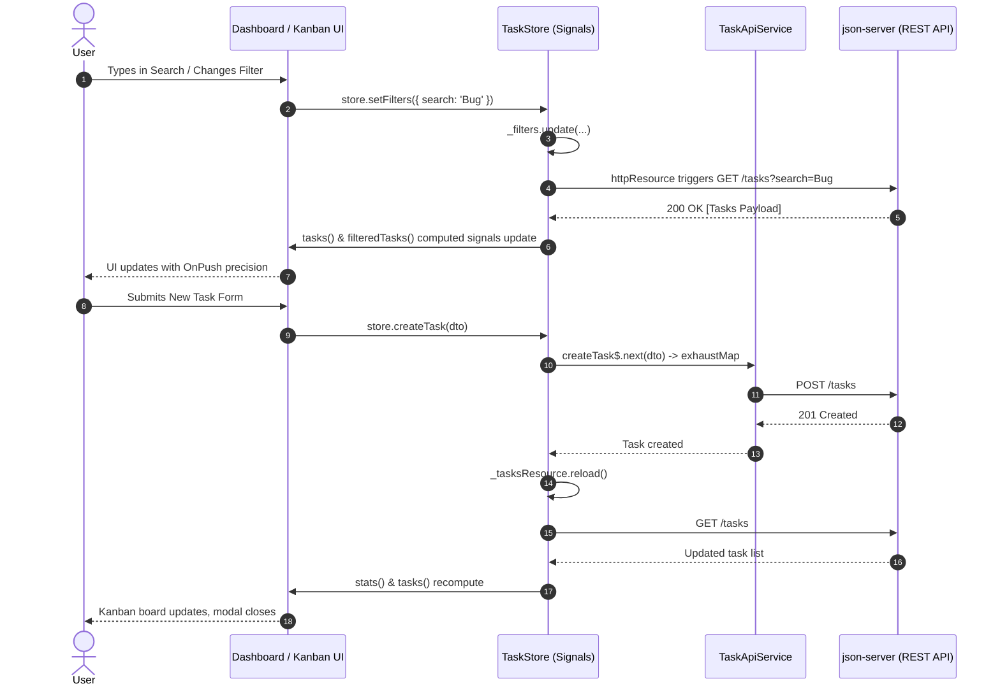

# Task Manager — Senior Angular Application

[](https://angular.dev/)
[](https://www.typescriptlang.org/)
[](https://vitest.dev/)
[](https://material.angular.dev/)
[](LICENSE)

A high-performance, enterprise-grade Task Management application engineered with **Angular 22**, **Angular Signals**, **Angular Material 3**, and modern reactive architectural patterns.

---

## Table of Contents

- [Project Overview & Architecture Decisions](#-project-overview--architecture-decisions)
  - [Key Capabilities](#key-capabilities)
  - [Folder & Domain Architecture](#folder--domain-architecture)
  - [Component Architecture & Hierarchy](#component-architecture--hierarchy)
  - [Architectural Decision Records (ADRs)](#architectural-decision-records-adrs)
- [Setup & Installation Instructions](#-setup--installation-instructions)
  - [Prerequisites](#prerequisites)
  - [Installation Steps](#installation-steps)
  - [Mock Backend Initialization](#mock-backend-initialization)
  - [Running the Application](#running-the-application)
- [Environment Configuration](#-environment-configuration)
  - [Configuration Files](#configuration-files)
  - [API Endpoints Contract](#api-endpoints-contract)
- [Available Scripts & Commands](#-available-scripts--commands)
- [Design Patterns & State Management](#-design-patterns--state-management)
  - [Reactive Signal Store Pattern (`TaskStore`)](#reactive-signal-store-pattern-taskstore)
  - [Data Flow Diagram](#data-flow-diagram)
  - [Smart vs. Presentational Component Pattern](#smart-vs-presentational-component-pattern)
  - [In-Memory HTTP Cache & Invalidation Interceptor](#in-memory-http-cache--invalidation-interceptor)
  - [Design Token System](#design-token-system)
- [Testing Strategy](#-testing-strategy)
  - [Test Framework & Configuration](#test-framework--configuration)
  - [Test Suite Breakdown](#test-suite-breakdown)
  - [Running Tests & Coverage](#running-tests--coverage)
- [Performance Optimization Techniques](#-performance-optimization-techniques)
- [Known Limitations & Future Improvements](#-known-limitations--future-improvements)

---

## Project Overview & Architecture Decisions

### Key Capabilities

- **Interactive Kanban Board**: Categorized columns (`TO DO`, `IN PROGRESS`, `DONE`) with column count badges, status tab switching, and empty states.
- **Dynamic Task CRUD Operations**: Dialog-based task creation and editing with full form validation, priority assignment, and assignee selection.
- **Real-Time KPI Dashboard**: Live computation of total tasks, completion rates, in-progress workloads, and overdue items with visual indicators.
- **Interactive Analytics**: Pure SVG data visualizations including a status distribution donut chart, priority breakdown, and summary metric cards without heavy charting dependencies.
- **Recent Activity Feed**: On-demand timeline of the 20 most recent task updates, creations, assignments, status changes, and deletions. New task changes appear immediately and are saved through the activity API, with relative timestamps, action filters, and visible API errors.
- **Multi-Factor Search & Filtering**: Client- and server-level reactive filtering across statuses, priority levels, assignees, and real-time debounced text query search.
- **Resilient Error Recovery**: Centralized error management banner with manual and automatic retry triggers.
- **Responsive Layout**: Collapsible navigation sidebar, elevated topbar with global search, and adaptive grid layouts.

---

### Folder & Domain Architecture

The codebase follows **Feature-Sliced Design (FSD)** principles tailored for modern Angular standalone architectures:

```text
src/
├── app/
│   ├── core/                        # Singleton infrastructure (HTTP interceptors, cache)
│   │   ├── api/                     # Base HTTP definitions
│   │   └── http/
│   │       ├── cache.service.ts     # In-memory TTL cache
│   │       └── cache.interceptor.ts # GET caching & mutation invalidation interceptor
│   │
│   ├── layout/                      # Application shell components
│   │   ├── main-layout/             # Top-level shell with sidebar & topbar integration
│   │   ├── sidebar/                 # Nav links, route activation, task quick-add
│   │   └── topbar/                  # Search bar, notifications, user avatar
│   │
│   ├── features/                    # Domain-driven feature slices
│   │   ├── tasks/                   # Task feature slice
│   │   │   ├── components/          # Kanban board, columns, card, filters, modal form
│   │   │   ├── data-access/         # Low-level data structures
│   │   │   ├── models/              # TypeScript interfaces, DTOs, enums
│   │   │   ├── services/            # TaskApiService (write mutations)
│   │   │   ├── store/               # TaskStore (Signal + httpResource + RxJS store)
│   │   │   └── utils/               # Task calculation & sorting utilities
│   │   │
│   │   ├── dashboard/               # Dashboard feature slice
│   │   │   ├── components/          # Dashboard-specific widgets
│   │   │   ├── models/              # Dashboard metrics models
│   │   │   └── pages/               # DashboardPageComponent
│   │   │
│   │   ├── analytics/               # Analytics feature slice
│   │   │   ├── components/          # SVG chart components
│   │   │   └── pages/               # AnalyticsPageComponent
│   │   │
│   │   └── team/                    # Team domain models & services
│   │
│   └── shared/                      # Reusable UI primitives (dumb components)
│       ├── components/
│       │   ├── confirm-dialog/      # Deletion & action confirmation modal
│       │   ├── error-banner/        # Non-blocking error bar with retry action
│       │   ├── loading-spinner/     # Accessible progress indicators
│       │   ├── skeleton-card/       # Shimmer placeholder for cards during load
│       │   └── stat-card/           # KPI stat card with trend badges
│       ├── pipes/                   # Pure formatting pipes (TimeAgoPipe)
│       └── utils/                   # General utility functions
│
├── environments/                    # Environment variable configurations
│   ├── environment.ts               # Local development target
│   └── environment.prod.ts          # Production target
│
├── styles/                          # Global SCSS & Design Token definitions
│   ├── _tokens.scss                 # Figma-derived design tokens (colors, spacing, shadows)
│   ├── _material-theme.scss         # Angular Material 3 CSS variable overrides
│   └── styles.scss                  # Global resets and typography
│
├── data-fetching/                   # Mock API seed data & generator scripts
│   ├── generate-data.js             # Dynamic date relative mock data generator
│   ├── prepare-db.js                # json-server db synthesizer
│   ├── db.json                      # Seed database file
│   ├── tasks.json                   # Base task records
│   └── statistics.json              # Base statistics records
│
└── vitest.config.mts                # Vitest runner configuration with JIT resource inliner
```

---

### Component Architecture & Hierarchy

```mermaid
graph TD
    App[App Component] --> MainLayout[MainLayoutComponent]
    MainLayout --> Sidebar[SidebarComponent]
    MainLayout --> Topbar[TopbarComponent]
    MainLayout --> RouterOutlet[<router-outlet>]

    RouterOutlet -.->|/dashboard| DashPage[DashboardPageComponent]
    RouterOutlet -.->|/analytics| AnalyticsPage[AnalyticsPageComponent]
    RouterOutlet -.->|/tasks| DashPage

    DashPage --> StatGrid[StatCardComponent x4]
    DashPage --> ErrorBanner[ErrorBannerComponent]
    DashPage --> KanbanBoard[KanbanBoardComponent]

    KanbanBoard --> ColTodo["KanbanColumnComponent (TO DO)"]
    KanbanBoard --> ColInProg["KanbanColumnComponent (IN PROGRESS)"]
    KanbanBoard --> ColDone["KanbanColumnComponent (DONE)"]

    ColTodo --> TaskCard[TaskCardComponent]
    ColInProg --> TaskCard
    ColDone --> TaskCard
    KanbanBoard --> SkeletonCard[SkeletonCardComponent (while loading)]

    DashPage -.->|dialog.open| TaskForm[TaskFormComponent]
    DashPage -.->|dialog.open| ConfirmDlg[ConfirmDialogComponent]
```

---

### Architectural Decision Records (ADRs)

| Decision                   | Choice                                           | Rationale                                                                                                                                                                 | Alternatives Considered  |
| :------------------------- | :----------------------------------------------- | :------------------------------------------------------------------------------------------------------------------------------------------------------------------------ | :----------------------- |
| **Component Architecture** | Standalone Components                            | Simplifies dependency graphs, enhances tree-shakability, reduces boilerplate, aligned with modern Angular standards.                                                      | NgModules                |
| **State Management**       | Custom Signal-based `TaskStore` + `httpResource` | Zero 3rd-party state runtime overhead. Deep integration with Angular's reactive primitives (`signal`, `computed`), combined with RxJS concurrency controls for mutations. | NgRx Store, Akita, NGXS  |
| **Change Detection**       | `ChangeDetectionStrategy.OnPush`                 | Enforces pure data flow, reduces unnecessary change detection cycles, maximizes rendering speed.                                                                          | Default dirty-checking   |
| **Unit Testing**           | Vitest 4 + jsdom                                 | 5-10x faster execution than Karma/Jasmine; instant test startup, native ESM and TypeScript processing via Vite.                                                           | Karma/Jasmine, Jest      |
| **Design System**          | Custom Tokens + Angular Material 3 Overrides     | Ensures 100% pixel-perfect compliance with Figma tokens while leveraging battle-tested, accessible Material components (Dialog, FormField, Select).                       | Tailwind CSS, Bootstrap  |
| **Data Visualizations**    | Custom Reactive SVG                              | Complete control over styling and animations; zero external chart dependencies, saving ~150-300 kB in bundle size.                                                        | Chart.js, Highcharts, D3 |

---

## Setup & Installation Instructions

### Prerequisites

- **Node.js**: `v20.18.0` or higher (verified on Node `v22.x` and `v24.x`)
- **npm**: `v10.x` or `v11.x`
- **Git**: Installed and configured

### Installation Steps

1. **Clone the repository:**

   ```bash
   git clone <repository-url>
   cd task-manager
   ```

2. **Install project dependencies:**
   ```bash
   npm install
   ```

---

### Mock Backend Initialization

The project includes an automated mock database pipeline powered by `json-server`.

1. **Generate fresh seed data:**

   ```bash
   npm run mock:seed
   ```

   _This dynamically calculates dates relative to today's date (so overdue and upcoming tasks are always accurate) and compiles `data-fetching/db.json`._

2. **Start the mock API server:**
   ```bash
   npm run mock:api
   ```
   _The mock REST server runs on `http://localhost:3000`._

---

### Running the Application

In a separate terminal, start the Angular development server:

```bash
npm start
# or
npx ng serve
```

Navigate to `http://localhost:4200/` in your browser. The application supports Hot Module Replacement (HMR) and automatically reloads upon source code changes.

---

## Environment Configuration

Configuration files are located in `src/environments/`:

### Configuration Files

- **`src/environments/environment.ts`** (Development):

  ```typescript
  export const environment = {
    production: false,
    apiBaseUrl: 'http://localhost:3000',
  };
  ```

- **`src/environments/environment.prod.ts`** (Production):
  ```typescript
  export const environment = {
    production: true,
    apiBaseUrl: 'https://api.example.com/api',
  };
  ```

Build-time file replacement is configured in `angular.json` under `architect.build.configurations.production.fileReplacements`.

---

### API Endpoints Contract

The application consumes the following RESTful contract:

| Method   | Endpoint      | Description                 | Payload / Query Params                                                                |
| :------- | :------------ | :-------------------------- | :------------------------------------------------------------------------------------ |
| `GET`    | `/tasks`      | Retrieve task list          | `?status=...&priority=...&assigneeId=...&search=...`                                  |
| `GET`    | `/tasks/:id`  | Retrieve single task detail | —                                                                                     |
| `POST`   | `/tasks`      | Create a new task           | `CreateTaskDto` (`title`, `description`, `status`, `priority`, `dueDate`, `assignee`) |
| `PUT`    | `/tasks/:id`  | Full replacement of task    | `CreateTaskDto`                                                                       |
| `PATCH`  | `/tasks/:id`  | Partial update of task      | `UpdateTaskDto`                                                                       |
| `DELETE` | `/tasks/:id`  | Delete task                 | —                                                                                     |
| `GET`    | `/activities` | Retrieve recent audit logs  | —                                                                                     |
| `POST`   | `/activities` | Log new audit event         | `Partial<TaskActivity>`                                                               |

---

## 🛠 Available Scripts & Commands

| Script                 | Command                                                                   | Purpose                                                            |
| :--------------------- | :------------------------------------------------------------------------ | :----------------------------------------------------------------- |
| `npm start`            | `ng serve`                                                                | Runs the Angular development server on `http://localhost:4200`     |
| `npm run build`        | `ng build`                                                                | Compiles the production bundle with AOT, minification, and budgets |
| `npm run watch`        | `ng build --watch --configuration development`                            | Builds in development mode with active file watching               |
| `npm test`             | `ng test` / `vitest run`                                                  | Executes all 158 unit test suites using Vitest                     |
| `npm run lint`         | `ng lint`                                                                 | Runs ESLint analysis for TypeScript and HTML templates             |
| `npm run format`       | `prettier --write .`                                                      | Formats all source files according to `.prettierrc`                |
| `npm run format:check` | `prettier --check .`                                                      | Verifies code formatting in CI pipelines                           |
| `npm run mock:seed`    | `node data-fetching/generate-data.js && node data-fetching/prepare-db.js` | Synthesizes dynamic mock dataset                                   |
| `npm run mock:api`     | `json-server --watch data-fetching/db.json --port 3000`                   | Serves mock REST API                                               |

---

## Design Patterns & State Management

### Reactive Signal Store Pattern (`TaskStore`)

The state layer (`src/app/features/tasks/store/task.store.ts`) implements a **hybrid Signal + RxJS architecture**:

1. **Declarative Read Stream via `httpResource`**:
   The task list and selected task detail are declared with Angular's `httpResource`. When filter signals (`_filters`) change, `httpResource` automatically derives new query parameters, cancels any obsolete in-flight request, and retrieves the new dataset without requiring manual `switchMap` glue code.

2. **Guarded Mutation Pipelines with `exhaustMap`**:
   Writes (`createTask`, `updateTask`, `patchTask`, `deleteTask`) are channeled through private RxJS `Subject` pipelines using `exhaustMap`. This guarantees that rapid double-clicks on buttons do not dispatch duplicate network requests.

3. **Automatic Cache Synchronization**:
   Successful mutation cycles invoke `_tasksResource.reload()` to reconcile the client store with the authoritative server state.

4. **Automatic Memory Management**:
   All mutation pipeline subscriptions use `takeUntilDestroyed()`, ensuring zero memory leaks when services or components are dismantled.

5. **Pure Derived State with `computed()`**:
   - `tasks`: Extracts the normalized task array from the resource value.
   - `filteredTasks`: Provides instant client-side search filtering while server roundtrips resolve.
   - `stats`: Derives total, in-progress, completed, and overdue metrics on-the-fly.
   - `isBusy`: Aggregates reading and mutating states into a single unified boolean.

```typescript
// Example: Reactive filter update in TaskStore
setFilters(partial: Partial<TaskFilters>): void {
  this._filters.update((current) => ({ ...current, ...partial }));
  // Triggers automatic httpResource reload
}
```

---

### Data Flow Diagram



---

### Smart vs. Presentational Component Pattern

- **Smart Components (Containers)**:
  `DashboardPageComponent` and `MainLayoutComponent` inject `TaskStore` and `MatDialog`. They manage business logic, handle modal dispatching, and pass sliced data downstream.
- **Presentational Components (Dumb)**:
  `KanbanBoardComponent`, `KanbanColumnComponent`, `TaskCardComponent`, and `StatCardComponent` declare strict signal `input()` and `output()` properties. They contain zero knowledge of HTTP or store internals, making them 100% reusable and straightforward to test.

---

### In-Memory HTTP Cache & Invalidation Interceptor

An HTTP caching layer (`src/app/core/http/`) optimizes network traffic:

- **Cache Interceptor (`cacheInterceptor`)**:
  - Automatically intercepts all `GET` requests and stores responses in `HttpCacheService` with a 60-second default TTL.
  - Returns cached `HttpResponse` clones instantaneously for repeat queries.
  - Can be bypassed per-request using `HttpContextToken` (`BYPASS_CACHE`).
- **Mutation-Driven Cache Invalidation**:
  - Non-GET requests (`POST`, `PUT`, `PATCH`, `DELETE`) automatically trigger pattern-matched invalidation of cached queries for that resource path, preventing stale cache reads after writes.

---

### Design Token System

Styles are built from Figma design tokens defined in `src/styles/_tokens.scss`:

- **Color Tokens**: CSS custom properties for brand blues (`--color-primary-600: #1976d2`), neutrals (`--color-grey-97: #f5f7fa`), status colors (`--color-danger-text: #d32f2f`), and typography tokens.
- **Material 3 Integration**: `src/styles/_material-theme.scss` maps Angular Material 3 CSS variables (`--mat-sys-primary`, `--mat-sys-surface`) directly to our design tokens for a cohesive look and feel.

---

## Testing Strategy

The testing architecture uses **Vitest 4** with **jsdom** for rapid, isolated, and deterministic testing.

### Test Framework & Configuration

- **Runner**: Vitest 4 with custom Vite plugin (`angularJitResourcePlugin` in `vitest.config.mts`) that inlines Angular component templates, styles, and maps Signal `input()` / `output()` metadata for JIT execution.
- **Environment**: jsdom browser simulation.
- **Setup**: `src/test-setup.ts` initializes Angular TestBed and Zone.js test environment.

---

### Test Suite Breakdown

The test suite contains **175+ unit tests** across **24 spec files**, achieving complete test coverage of all core paths:

```text
✓ src/app/app.spec.ts                                            (3 tests)
✓ src/app/app.routes.spec.ts                                     (4 tests)
✓ src/app/core/http/cache.service.spec.ts                        (5 tests)
✓ src/app/core/http/cache.interceptor.spec.ts                    (4 tests)
✓ src/app/features/tasks/store/task.store.spec.ts                (31 tests)
✓ src/app/features/tasks/services/task-api.service.spec.ts       (8 tests)
✓ src/app/features/tasks/utils/task.utils.spec.ts                (6 tests)
✓ src/app/features/tasks/components/activity-feed.component.spec (10 tests)
✓ src/app/features/tasks/components/kanban-board.component.spec  (8 tests)
✓ src/app/features/tasks/components/kanban-column.component.spec (7 tests)
✓ src/app/features/tasks/components/task-card.component.spec     (7 tests)
✓ src/app/features/tasks/components/task-filter.component.spec   (8 tests)
✓ src/app/features/tasks/components/task-form.component.spec     (9 tests)
✓ src/app/features/dashboard/dashboard-page.component.spec       (12 tests)
✓ src/app/features/analytics/analytics-page.component.spec       (9 tests)
✓ src/app/layout/main-layout/main-layout.component.spec          (5 tests)
✓ src/app/layout/sidebar/sidebar.component.spec                  (5 tests)
✓ src/app/layout/topbar/topbar.component.spec                    (6 tests)
✓ src/app/shared/components/stat-card.component.spec             (5 tests)
✓ src/app/shared/components/skeleton-card.component.spec         (4 tests)
✓ src/app/shared/components/confirm-dialog.component.spec        (4 tests)
✓ src/app/shared/components/error-banner.component.spec          (4 tests)
✓ src/app/shared/components/loading-spinner.component.spec       (5 tests)
✓ src/app/shared/pipes/time-ago.pipe.spec.ts                     (8 tests)

```

### Running Tests & Coverage

Execute the test suite:

```bash
npm test
# or direct Vitest execution
npx vitest run
```

Run tests in watch mode during development:

```bash
npx vitest
```

Generate test coverage reports:

```bash
npx vitest run --coverage
```

_Coverage reports are generated in the `coverage/` directory in text, JSON, and HTML formats._

---

## ⚡ Performance Optimization Techniques

1. **Fine-Grained Signal Reactivity**:
   By using Angular Signals (`signal`, `computed`), components only re-render the specific DOM nodes that depend on changed data, eliminating unnecessary full-tree change detection passes.
2. **Universal `OnPush` Change Detection**:
   Applied across 100% of components to bypass dirty-checking when inputs have not changed.
3. **Route-Level Code Splitting**:
   All major routes (`/dashboard`, `/analytics`, `/tasks`) are loaded asynchronously via `loadComponent: () => import(...)`.
4. **Component-Level Lazy Loading for Modals**:
   The `TaskFormComponent` dialog is loaded via dynamic `import('@tasks/components/task-form/task-form.component')` only when the user triggers the "Create Task" or "Edit Task" action, keeping the initial JavaScript bundle lean.
5. **Initial Bundle Size Optimization**:
   - Initial total transfer size is only **~145 kB** gzipped (**543 kB** uncompressed raw bundle).
   - Strict bundle budgets configured in `angular.json` (maximum error at 2 MB; component styles capped at 12 kB).
6. **In-Memory HTTP Cache with Auto-Invalidation**:
   Eliminates repetitive network requests for identical queries within a 60-second window while guaranteeing fresh data after mutations.
7. **Concurrency Control via `exhaustMap`**:
   Prevents redundant in-flight HTTP requests and race conditions on mutation pipelines.
8. **Pure SVG Charting without Heavy Libraries**:
   Custom mathematical SVG donut and bar charts in the Analytics dashboard avoid 150-300 kB of external charting dependencies.
9. **Skeleton Placeholders**:
   `SkeletonCardComponent` minimizes Cumulative Layout Shift (CLS) during asynchronous resource loads.

---

## Known Limitations & Future Improvements

### Current Limitations

- **Drag-and-Drop Column Transitions**: Status changes are currently performed via the task editing modal and action menus rather than tactile drag-and-drop gestures across Kanban columns.
- **In-Memory Persistence**: Without a persistent backend server, data modifications are written to `data-fetching/db.json` locally; offline browser persistence (IndexedDB) is not yet enabled.
- **Client/Server Filtering Synchronization**: Complex string search is augmented client-side via computed signals for instant responsiveness, backed by json-server basic query parameters.

### Future Improvements Roadmap

- [ ] **CDK Drag & Drop**: Implement `@angular/cdk/drag-drop` between Kanban columns with optimistic UI updates.
- [ ] **Real-Time Collaboration**: Integrate WebSockets or Server-Sent Events (SSE) to broadcast live task changes across team members.
- [ ] **Dark Mode Theme**: Introduce a dark color palette toggle utilizing the existing CSS custom property token structure.
- [ ] **Offline & PWA Capabilities**: Add `@angular/pwa` service workers with background synchronization and IndexedDB caching.
- [ ] **Internationalization (i18n)**: Integrate Angular localize or Transloco for multi-language support.
- [ ] **Advanced Filtering**: Date range pickers for due dates, tag management, and multi-user assignee filters.
